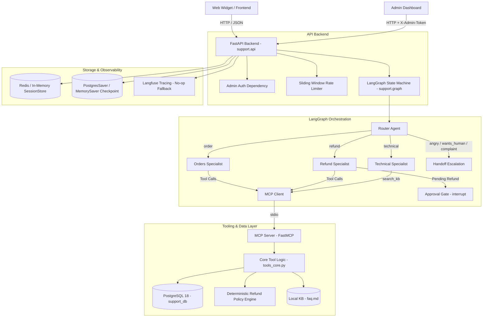

# System Architecture: Multi-Agent Customer Support System

This document outlines the end-to-end architecture, component layout, and data flow of the Multi-Agent Customer Support System.

---

## 1. High-Level Architecture Overview

---

## 2. Component Details

### 2.1 FastAPI Backend (`src/support/api.py`)
- **Lifecycle Management (`lifespan`)**: Initialises database connection pools and the long-lived MCP client background session upon startup. Flushes Langfuse traces and gracefully tears down connection pools and processes upon shutdown.
- **CORS Support**: Configured for `http://localhost:5173` (Vite dev server) and localhost development ports.
- **Rate Limiting**: Sliding-window rate limiter enforcing a maximum of 20 customer messages per minute per session.
- **Input Validation**: Enforces length constraints (messages up to 1000 characters) via Pydantic v2 schemas.
- **PII-Safe Logging**: Middleware logs HTTP method, route, status code, and latency without logging sensitive message contents or auth headers.
- **Admin Security**: Validates `X-Admin-Token` header using constant-time comparison against `config.ADMIN_TOKEN`, returning 401 on missing tokens and 403 on invalid tokens.

### 2.2 Customer Endpoints
- `POST /api/login`: Demo identity lookup by email; generates a unique `session_id` and binds `customer_id` server-side in the session store.
- `POST /api/chat`: Validates rate limits and active session binding; executes message turn through the LangGraph engine; returns reply, intent, and status (`answered`, `awaiting_approval`, `handed_off`).
- `GET /api/sessions/{session_id}/messages?after=<id>`: Retrieves conversation history for polling widgets, supporting incremental updates with message ID filtering.

### 2.3 Admin Endpoints
- `GET /api/admin/refunds?status=pending`: Lists pending refunds joined with order details and customer contact information.
- `POST /api/admin/refunds/{id}/decision`: Submits admin decision (`approve` / `reject`); enforces idempotency (duplicate decisions return 409 Conflict); resumes paused LangGraph threads via `graph.resume_approval` and inserts customer notification messages.
- `GET /api/admin/handoffs?status=open`: Lists open escalations with customer summaries and trigger reasons.
- `GET /api/admin/handoffs/{id}`: Returns complete handoff details including conversation transcript JSON.
- `POST /api/admin/handoffs/{id}/resolve`: Updates escalation status to resolved with timestamp.
- `GET /api/health`: Provides system health and database connectivity diagnostics.

---

## 3. Security & Safety Invariants
1. **Never Finalize Money Without Human Approval**: Refunds are created strictly in `pending` state; only the admin endpoint calling `tools_core.finalize_refund` can finalize a refund.
2. **Deterministic Customer ID Injection**: The LLM is never exposed to `customer_id` fields in tool schemas. The authenticated `customer_id` is injected strictly server-side by `mcp_client.py`.
3. **Prompt-Injection Defense**: User messages and tool outputs are treated strictly as untrusted data in agent system prompts.
